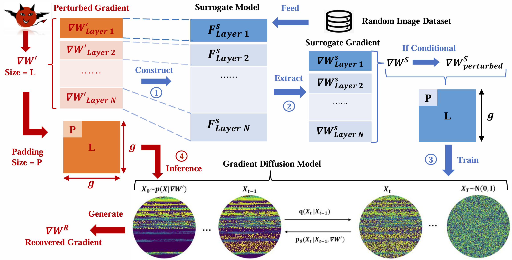
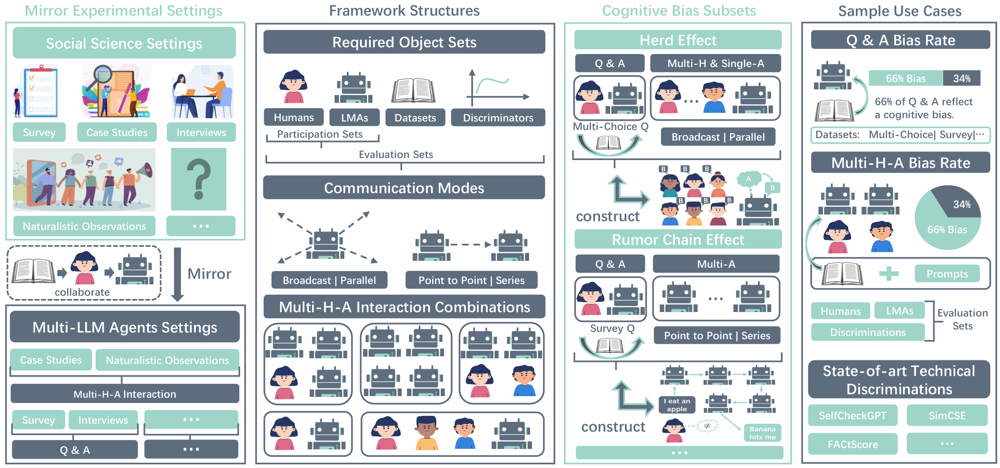
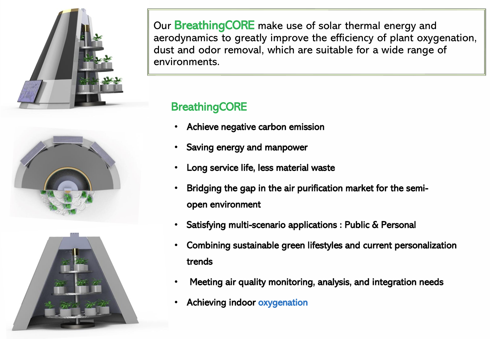
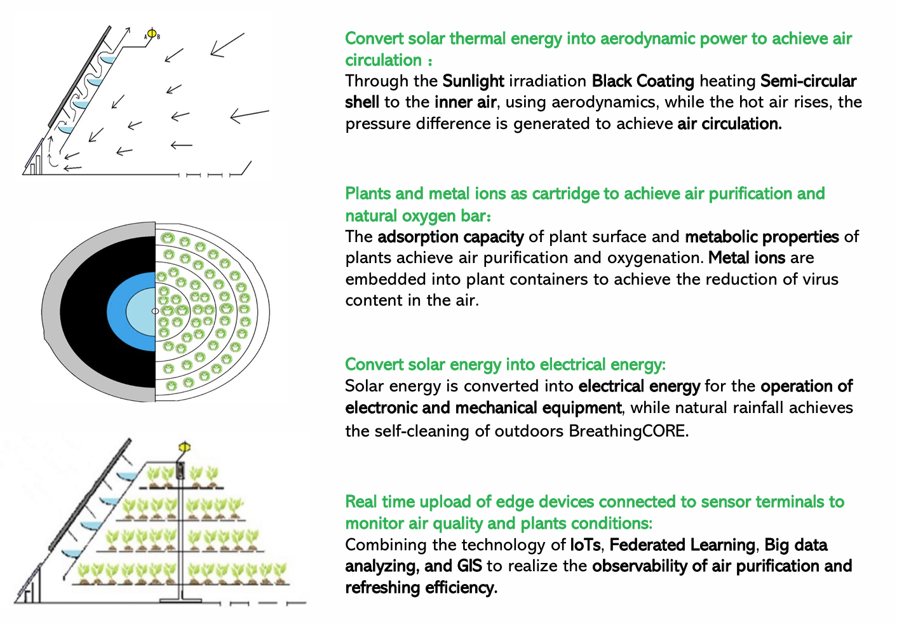
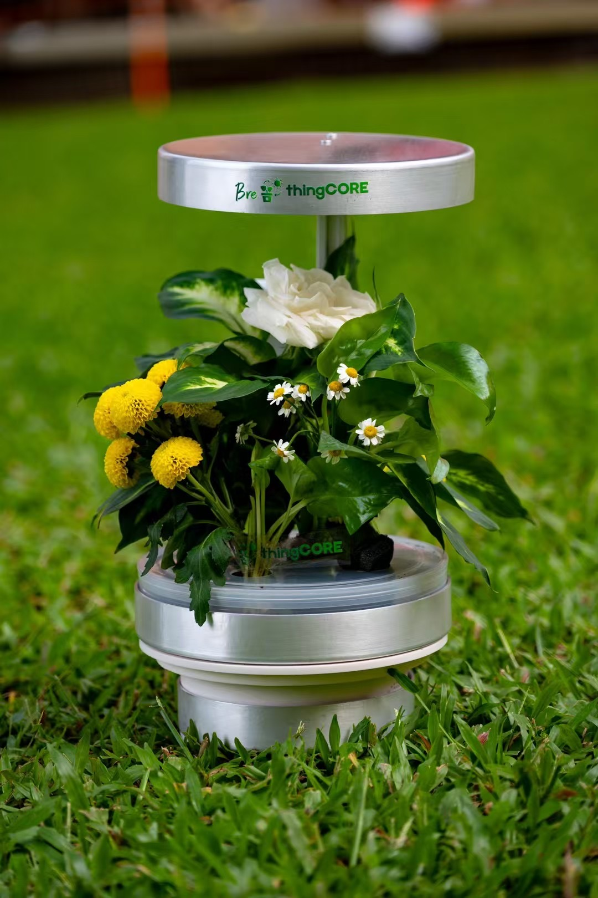
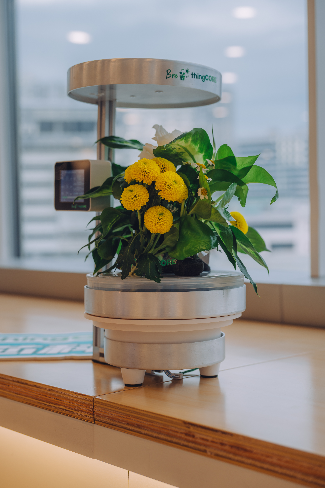
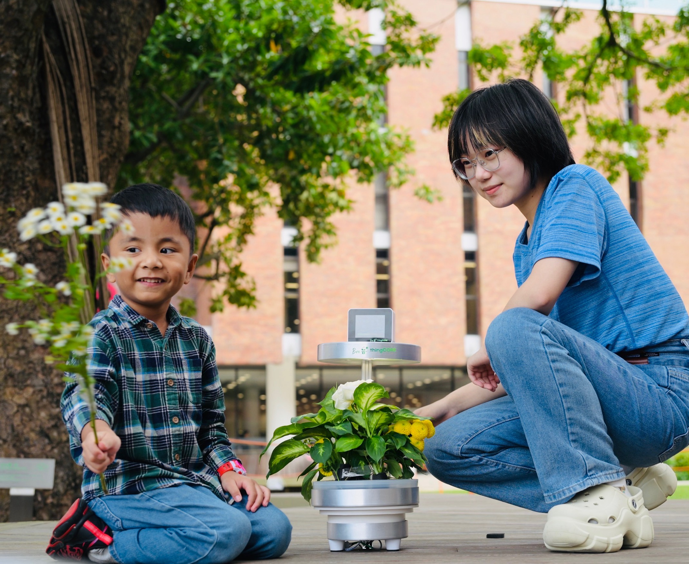
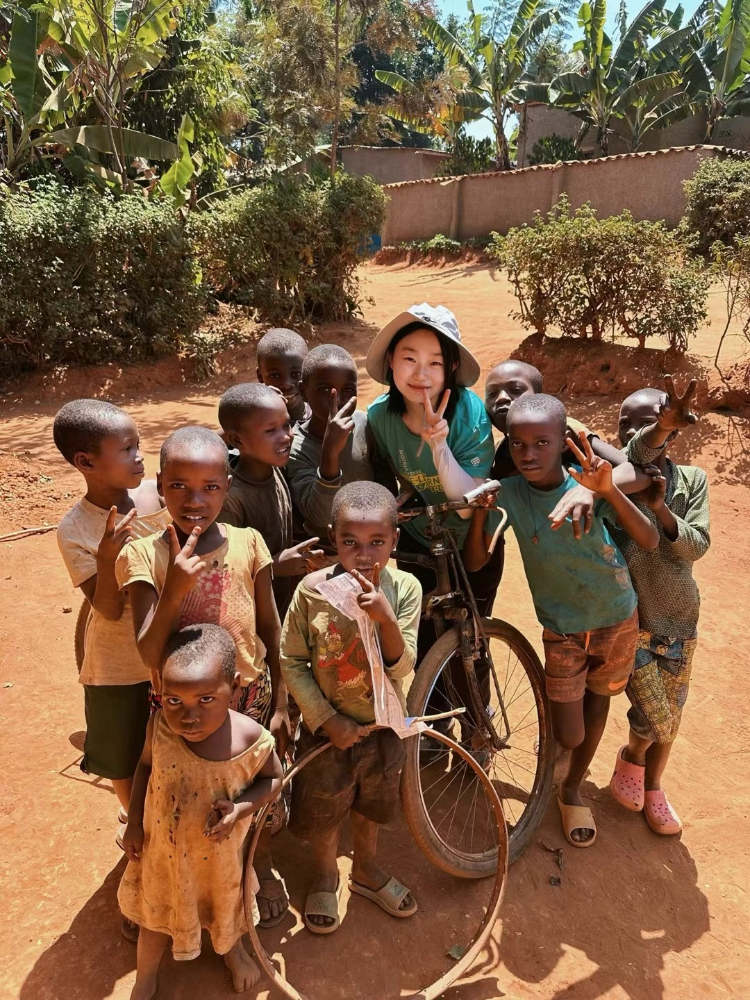
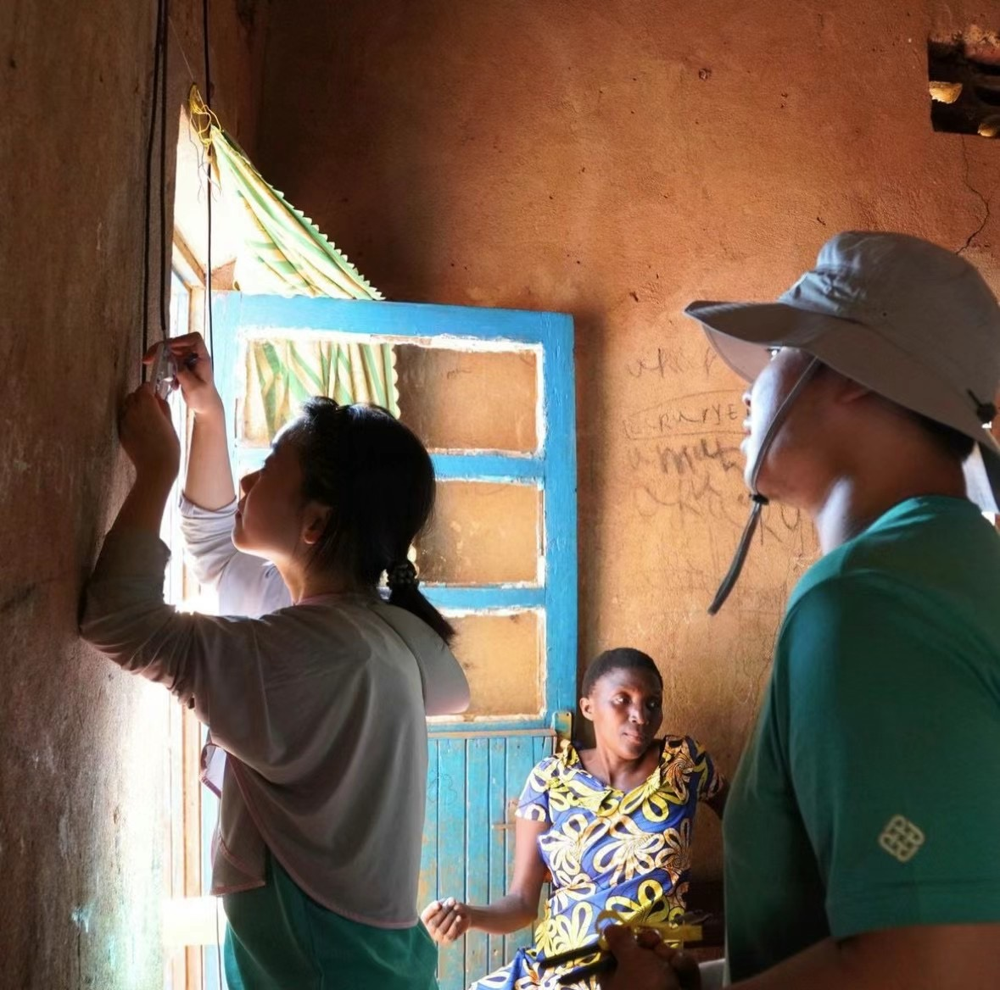

Hello! 😊 I'm Xuan Liu, a senior-year Electronic and Information Engineering undergraduate at [Hong Kong Polytechnic University](https://www.polyu.edu.hk/eee/). I'm a highly self-motivated researcher and innovator with a robust ability in execution and leadership.

My research interests lie in Trustworthy & Cognitive AI, Privacy, Large-Scale Models, and Attack & Defense Algorithms. I'm honored to be supervised by [Prof. Song Guo, at HKUST](https://cse.hkust.edu.hk/~songguo/) (Hong Kong) during my undergraduate period. Also, I'm thankful for the mentorship by [Prof. Quanyan Zhu, at NYU](https://engineering.nyu.edu/faculty/quanyan-zhu) (New York) on interdisciplinary research on Multi-Agent LLM system for social science during Spring 2024. In the summer, I was on my Research Internship with [Prof. Xiaoxiao Li, at UBC](https://ece.ubc.ca/xiaoxiao-li/) (Vancouver) on building the distributed training system for Large-Scale Models.

In addition to academic pursuits, I'm the founder of [BreathingCORE](https://breathingcore.com/), an eco-friendly IoTs technology startup in Hong Kong. I am also an inventor with patents in sustainable energy & negative carbon-related technologies.

For more details about me, please reach out at xuan18.liu@connect.polyu.hk. I am applying for the Fall 2025 PhD program in EECS OR Cognitive-related fields! I can't wait to contribute innovative ideas and productive work ethics to your team！

## 🌟 Major Papers & Projects 

## 🛡️ Topic 1: AI Privacy, Attack & Defense Algorithms

- **Xuan Liu**, Siqi Cai, Qihua Zhou, Song Guo, Ruibin Li, Kaiwei Lin *“**Mjölnir:** Breaking the Shield of Perturbation-Protected Gradients via Adaptive Diffusion”* Preprint Version: [https://arxiv.org/abs/2407.05285](https://arxiv.org/abs/2407.05285) **AAAI-2025** (2024)
  
  

  
  

- **Xuan Liu**, Siqi Cai, Renjie He, Jingling Yuan *“Mutual Gradient Inversion: Unveiling Privacy Risks of Federated Learning on Multi-modal Signals”* [https://ieeexplore.ieee.org/document/10663250](https://ieeexplore.ieee.org/document/10663250) **IEEE Signal Processing Letters** (2024)  

- **Xuan Liu**, Siqi Cai, Lin Li, Rui Zhang, Song Guo *“MGIA: Mutual Gradient Inversion Attack in Multi-Modal Federated Learning”* [https://doi.org/10.1609/aaai.v37i13.26995](https://doi.org/10.1609/aaai.v37i13.26995) **AAAI-2023** (2023)

## 🤖 Topic 2: Multi-Agent LLM & LLM Cognition

- **_Preprint on-going work_**
  
  **Xuan Liu**, Jie Zhang, Song Guo, Haoyang Shang, Chengxu Yang, Quanyan Zhu  
  *“Exploring Prosocial Irrationality for LLM Agents: A Social Cognition View”*  
  [https://arxiv.org/abs/2405.14744](https://arxiv.org/abs/2405.14744) (2024)

  

  
  

  
## 🌱 Topic 3: AIoTs & Eco-friendly Invented Product 

- **_Chinese Patent_**
  
  **CN 109589733 B**: An environmentally friendly outdoor dust reduction device using solar thermal energy.
  

  
  
  

- **_Newly invented Pre-sale Product "GreenOxy"_**

  **GreenOxy-A Living Air Purifier:** My newly designed, innovative air purifier. Initially hand-crafted, it is now available for pre-sale. This unique product combines advanced technology with natural elements, bringing vitality and serenity to your daily life.
  

  
  
  
  

- **_For More Information, Please Visit My Start-up Company Website_**:  
  [https://breathingcore.com](https://breathingcore.com)

## 🚀 What's New
_2024-12_ 📝 Xuan's _first author_ work ["Mjölnir: Breaking the Shield of Perturbation-Protected Gradients via Adaptive Diffusion"](https://arxiv.org/abs/2407.05285) has been accepted by **_AAAI-2025_**. 
_2024-12_ 📝 Xuan's _co-author_ work "PriFairFed: A Local Differentially Private Federated Learning Algorithm for Client-Level Fairness" has been accepted by **_IEEE Transactions on Mobile Computing_**. 
_2024-8_ 📝 Xuan's _first author_ work ["Mutual Gradient Inversion: Unveiling Privacy Risks of Federated Learning on Multi-modal Signals"](https://ieeexplore.ieee.org/document/10663250) has been accepted by **_IEEE Signal Processing Letters_**. 
_2024-4_  🏆 Xuan received the [**_Best_** Undergraduate Research Project Award](https://www.polyu.edu.hk/eee/news-and-events/news/2024/2024-02-21-best-uris-research-project-award-2023/)! See University Official Posts & Interview at [Instagram](https://www.instagram.com/p/C6VELkGy9f6/?utm_source=ig_web_copy_link&igsh=MzRlODBiNWFlZA==), [LinkedIn](https://www.linkedin.com/feed/update/urn:li:activity:7190543155698491392). 
_2024-1_  Xuan's Start-up BreathingCORE won MicroFund Shortlisted Team and has been selected for [Hong Kong Science and Technology Park](https://www.hkstp.org/) Incubation Program! 
_2023-12_ Xuan won ["Outstanding Proposal of Belt and Road Initiatives Youth Creative International Challenge"](https://connectpolyu-my.sharepoint.com/:i:/g/personal/21097411d_connect_polyu_hk/EQ9nYNABWbRAq_S7zVveNOkBpYFuOgWINgZt4Dh6DFtylw?e=wEjeiZ). See University Official Posts at [Facebook](https://www.facebook.com/polyueee/photos/-congratulations-to-our-students-on-winning-the-second-prize-in-the-belt-and-roa/724634839855179/?_rdr)  
_2023-11_ Xuan received ["98th IEEE-VTC Fall Volunteer Service Award"](https://connectpolyu-my.sharepoint.com/:i:/g/personal/21097411d_connect_polyu_hk/EX9J3McaMhtEpu8iwjxmEYEBx8qVzrv_WHHHYsntXwZmzg?e=52LolZ). 
_2023-9_ 🏆 Xuan won "**_Champion_** of Innovation & Entrepreneurship Training Camp Roadshow," securing a 7K CNY cash award.  
_2023-7_ Xuan received ["Department of Electronic and Information Engineering Scholarship 
for Hall Residents"](https://connectpolyu-my.sharepoint.com/:b:/g/personal/21097411d_connect_polyu_hk/EU3wMSH_0gJBmCfSwekowYYBe0QqHLeUwsYktqGOgUrEGQ?e=0C1unW), for the Top 1 GPA in the academic year of 2022 in the Dept. 
_2023-4_  Xuan received ["Hong Kong Government-Researching Out Award"](https://connectpolyu-my.sharepoint.com/:i:/g/personal/21097411d_connect_polyu_hk/EdsgREGzomZOlyhDSZONzesB6gFqX3AWZSwxVq9PDpTeyQ?e=jsPPgb). 
_2023-4_  Xuan received ["Hong Kong Government-Talent Development Scholarship"](https://connectpolyu-my.sharepoint.com/:i:/g/personal/21097411d_connect_polyu_hk/EZ47dCrjnvhJrfY9_5G-3voBf-tIbqbUVPvK4Tqgs1RCNA?e=XZ9pTd). 
_2023-2_ 📝 Xuan's _first author_ work ["MGIA: Mutual Gradient Inversion Attack in Multi-Modal Federated Learning"](https://ojs.aaai.org/index.php/AAAI/article/view/26995) has been published on **_AAAI-2023_**. 
_2022-12_ Xuan received ["Dr. Winnie S M Tang-PolyU Student 
Innovation & Entrepreneurship Scholarship "](https://connectpolyu-my.sharepoint.com/:b:/g/personal/21097411d_connect_polyu_hk/EeFzM5bicaRDuOSs1eN3o6ABUGMtNnDDJfDY3wHWa64SJw?e=otbc8A). 
_2022-11_ 🏆 Xuan won ["**_Best_** GPA Award"](https://connectpolyu-my.sharepoint.com/:i:/g/personal/21097411d_connect_polyu_hk/EXSvkpdj16tCnOEy9G2wQc4B3TyN5NoamK7XcZaKQ5eM0w?e=IXneLw) Department of Electronic and Information Engineering. 
_2022-8_  Xuan received the "Shenzhen Innovation & Entrepreneurship Competition **_Outstanding_** Award," securing a 7K CNY cash award. 

## 🌍 Moments

  

  
  
  

  

  
   
  

