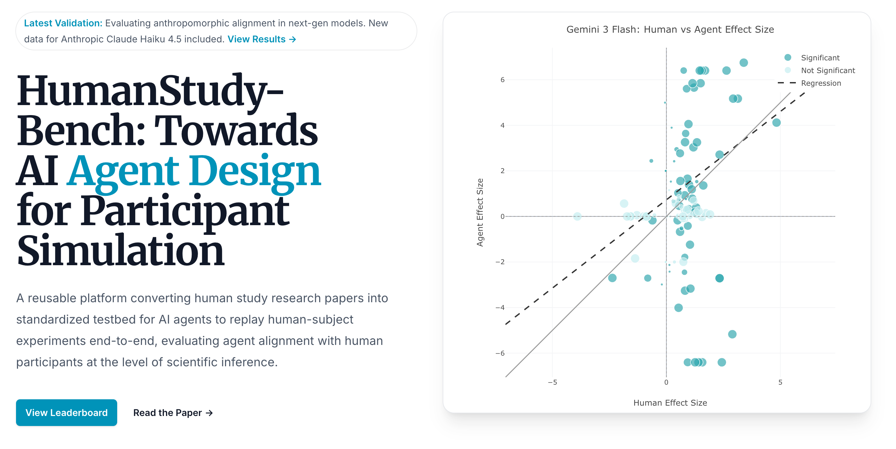
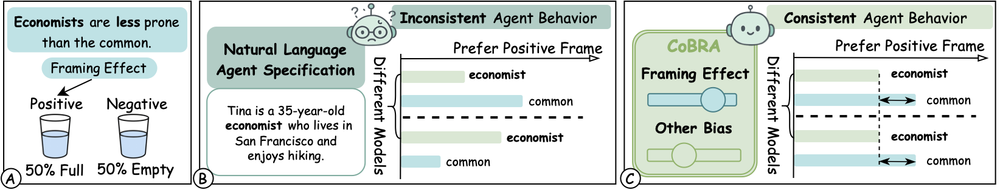
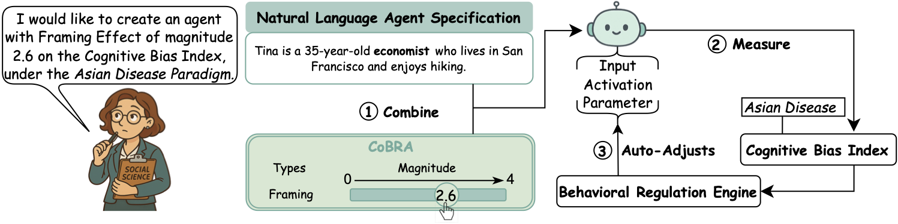

My research sits at the intersection of <strong>machine learning, social psychology, and human-computer interaction</strong>.

I focus on three main directions:

<ul>
  <li><strong>Exploring human-like intelligence</strong> in modern AI models (e.g., LLMs and VLMs), such as cognitive biases that mirror human social cognition</li>
  <li><strong>Building practical AI tools</strong> to accelerate social science research and human behavior understanding</li>
  <li><strong>Addressing the societal aspects of AI</strong>, including privacy protection, security, and sustainable technology innovation</li>
</ul>

<h2 class="section-title">Featured Works</h2>

  

    
  

  

    

      <strong>Xuan Liu</strong>, Haoyang Shang, Zizhang Liu, Xinyan Liu, Yunze Xiao, Yiwen Tu, Haojian Jin. <a href="https://arxiv.org/abs/2602.00685">"HumanStudy-Bench: Towards AI Agent Design for Participant Simulation"</a> <em>arXiv 2026</em> [<a href="https://www.hs-bench.clawder.ai/">Leaderboard</a>] [<a href="https://github.com/AISmithLab/HumanStudy-Bench">Code & Data</a>]
    

  

  

    
    
  

  

    

      <strong>Xuan Liu</strong>, Haoyang Shang, Haojian Jin. <a href="https://arxiv.org/abs/2509.13588">"CoBRA: Programming Cognitive Bias in Social Agents using Classic Social Science Experiments"</a> <em>CHI 2026</em> [<a href="https://github.com/assassin808/CoBRA">Code</a>]
    

  

  

    
  

  

    

      <strong>Xuan Liu</strong>, Jie Zhang, Song Guo, Haoyang Shang, Chengxu Yang, Quanyan Zhu. <a href="https://arxiv.org/abs/2405.14744">"Exploring Prosocial Irrationality for LLM Agents: A Social Cognition View"</a> <em>ICLR 2025</em> [<a href="https://github.com/XuanL17/CogMir">Code</a>]
    

  

  

    
  

  

    

      <strong>Xuan Liu</strong>, Siqi Cai, Qihua Zhou, Song Guo, Ruibin Li, Kaiwei Lin. <a href="https://arxiv.org/abs/2407.05285">"Mjölnir: Breaking the Shield of Perturbation-Protected Gradients via Adaptive Diffusion"</a> <em>AAAI 2025</em> [<a href="https://github.com/XuanL17/Mjolnir">Code</a>]
    

  

  

    
  

  

    

      <strong>Xuan Liu</strong>, Siqi Cai, Lin Li, Rui Zhang, Song Guo. <a href="https://doi.org/10.1609/aaai.v37i13.26995">"MGIA: Mutual Gradient Inversion Attack in Multi-Modal Federated Learning"</a> <em>AAAI 2023</em> [<a href="https://github.com/XuanL17/MGIA">Code</a>]
    

  

  

    
  

  

    

      <strong>Chinese Patent CN 109589733 B</strong> — <em>An environmentally friendly outdoor dust reduction device using solar thermal energy.</em>
    

  

  

    
    
  

  

    

      <strong>GreenOxy: A Living Air Purifier</strong> — Combining advanced technology with natural elements to bring vitality and serenity to daily life.
    

    

      [<a href="https://breathingcore.com">Start-up Website</a>]
    

  

  <a href="https://scholar.google.com/citations?user=AyzRO-wAAAAJ&hl=en">
    <i class="ai ai-google-scholar"></i>Full list of papers on Google Scholar →
  </a>

